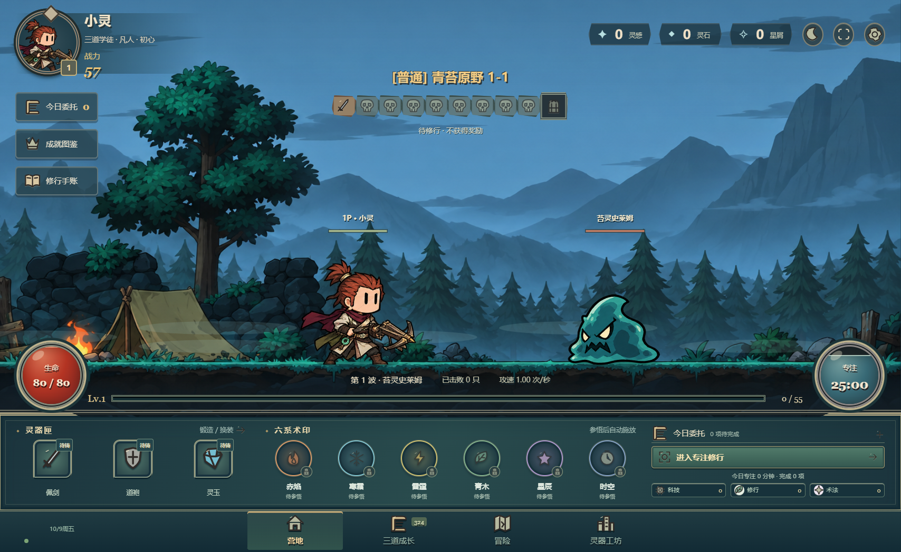

# 灵枢 · 专注纪元

把学习和完成现实事项，变成科技、修仙与术法世界的成长。一款横屏离线学习 RPG，包含 324 个成长节点、9 个职业、8 个地区、装备外观、待办和专注计时。实时战斗按攻速独立出手；只有专注和完成任务获得奖励，纯挂机不升级。从零经验、零货币开始。

## 运行

下载仓库后，用 Edge 或 Chrome 打开 `focus-era/index.html`。不需要安装依赖或启动服务器。存档保存在当前浏览器内，可通过游戏设置导出、导入。

[游戏说明与验证方法](focus-era/README.md) · [实时攻速对比录像](focus-era/preview-speed.webm) · [验证记录](focus-era/验证结果.md)

个人存档、浏览器配置、测试数据和开发依赖不随仓库上传。素材来源与许可说明见游戏目录。
